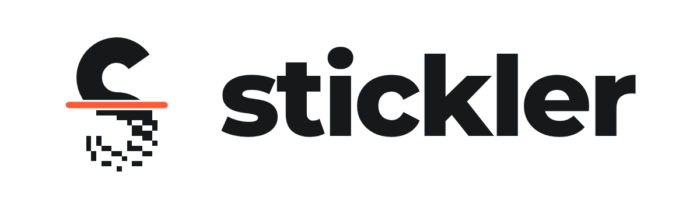

  <picture>
    <source media="(prefers-color-scheme: dark)" srcset="branding/lockup-dark.png">
    
  </picture>

A label designer for the Fichero D11s and MXW01 thermal printers. No account, no ads, no tracking.

---

Stickler is an independent app for two affordable Bluetooth thermal printers: the
[Fichero](https://www.action.com/nl-nl/p/3212141/fichero-labelprinter/) label printer sold at Action, and MXW01 mini
printers on 57 mm paper. It only asks for what it needs: Bluetooth to reach the printer (plus location on Android 11
and older, where Android requires it for Bluetooth scans) and the camera when you scan a code. It has no internet
access, no account and no ads.

## What it does

- **Design labels:** text, images, QR codes, barcodes (EAN-13/8, UPC-A/E, ITF, Code 39/93/128, Codabar), lines and
  shapes, on the Fichero label rolls, 57 mm rolls or a custom size
- **Auto length** on 57 mm rolls: the label grows with its content and prints only as long as needed
- **Print photos well on a 1-bit printer:** Auto (the default: crisp text, Atkinson-dithered photos), Atkinson,
  Floyd–Steinberg, blue noise and Werness dithering, with dot correction so greys come out the way they look on
  screen
- **See it before you print it:** a simulated preview of how the thermal dots spread, fitted to test prints of each
  printer
- **Copy codes:** scan a QR code or barcode with the camera, or read it from a picture (like a screenshot of a Wi-Fi
  share code), and get an editable copy on the label. Pictures shared to Stickler from other apps work too
- **Batch print** from a data table, one label per row
- **Calibrate** from the app menu: print a grey test and measure it with the camera or from a photo, and Stickler
  fits the dot correction to your printer. Keep several corrections and compare them, and print a check to see
  whether greys land where they should. The Fichero's labels also get an offset test strip
- **Several printers:** Stickler remembers them and connects to whichever one is switched on
- **Save** labels on the device and export them as JSON or PNG
- **In five languages:** English, Dutch, German, Spanish and Polish

How to use each feature: [docs/GUIDE.md](docs/GUIDE.md), also on
[stickler.julianlorenzon.com/guide.html](https://stickler.julianlorenzon.com/guide.html).

## Get it

Stickler runs on Android 6.0 or newer and is on its way to Google Play; see
[stickler.julianlorenzon.com](https://stickler.julianlorenzon.com/). To build it yourself, see
[docs/BUILDING.md](docs/BUILDING.md).

## The printers

- **Fichero D11s:** internally an AiYin D11s, a 96-dot printhead at 203 DPI that prints 1-bit images onto 14 mm
  labels over Bluetooth Low Energy. The protocol is documented in [docs/PROTOCOL.md](docs/PROTOCOL.md).
- **MXW01:** a 57 mm pocket printer sold under many brand names, often with the Fun Print app; it shows up as
  "MXW01" in Bluetooth. A 384-dot printhead at 203 DPI prints the middle 48 mm of the paper. Stickler follows the
  protocol documented in [MXW01-catprinter](https://github.com/dave9123/MXW01-catprinter), checked on a real printer
  ([src/lib/printer/drivers/mxw01.ts](src/lib/printer/drivers/mxw01.ts)). Older "cat printers" that use the iPrint
  app speak a different protocol and aren't supported.

Each printer family is a driver in [src/lib/printer/drivers](src/lib/printer/drivers).

## Credits

Stickler started as a fork of [fichero-printer](https://github.com/0xMH/fichero-printer) by Hamza (0xMH), who
reverse engineered the Fichero's protocol and wrote the first web version
([blog post](https://blog.dbuglife.com/reverse-engineering-fichero-label-printer/)). The label designer grew out of
[NiimBlue](https://github.com/MultiMote/niimblue) by MultiMote, and the threshold and Atkinson dithering code comes
from [CanvasDither](https://github.com/NielsLeenheer/CanvasDither) by Niels Leenheer. MXW01 support follows the
protocol documented by dave9123 in [MXW01-catprinter](https://github.com/dave9123/MXW01-catprinter). The app's About
screen lists every open source component and its licence.

Stickler is not affiliated with Action, Fichero, AiYin or the makers of MXW01 printers.

## Licence

Stickler is free software under the [GNU GPL, version 3 or later](LICENSE). Parts that come from fichero-printer,
NiimBlue and CanvasDither keep their MIT licence; [NOTICE](NOTICE) has their notices. The barcode reader is
[zxing-cpp](https://github.com/zxing-cpp/zxing-cpp) (Apache-2.0), compiled to WebAssembly by
[zxing-wasm](https://github.com/Sec-ant/zxing-wasm) (MIT).
